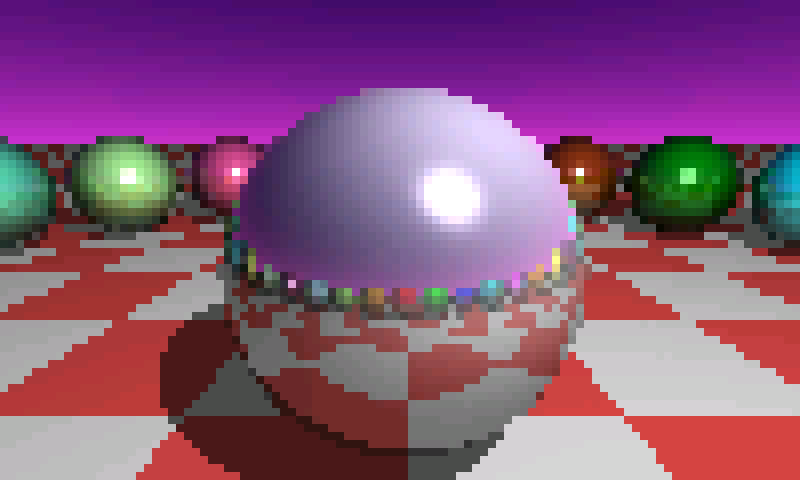
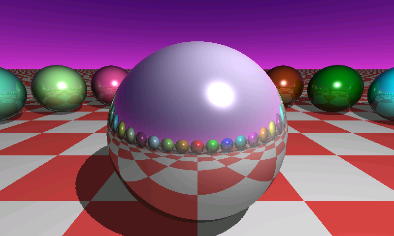

# CrowBench


**Period-accurate PC benchmarks, running on a $40 touchscreen.**

CrowBench is a benchmark manager for the Elecrow CrowPanel 7" ESP32-S3 (800×480 RGB). It takes the benchmarks that measured 90s PCs, the ones that shipped with SDKs, ran in magazine labs, and printed numbers people argued about on Usenet, and compiles their **original source** for a microcontroller. It doesn't recreate them, re-implement them from a description, or approximate them. The tests are the originals, ported.

Results land on a touch UI styled after the control panels those benchmarks came from, and every run is saved to SD.

```
 CROWBENCH / BENCHMARK MANAGER                    ESP32-S3  800x480
 ------------------------------------------------------------------
 GRAPHICS                    | RUN   BENCHMARK                STATUS
  SciTech SVGAKit Profile    | 0002  SciTech SVGAKit Profile  COMPLETE
  CrowBench Raytrace         | 0001  SciTech SVGAKit Profile  COMPLETE
                             |
 [ RUN SELECTED ]            | CPU CLOCK              240 MHz
                             | MEMORY CLEAR          31.1 MiB/s
                             | MEMORY REVERSE CLEAR  30.9 MiB/s
```

---

## The rule

> **Every period benchmark must trace to an original source file with a real license grant.**

Compiling 1991 C for Xtensa is a **port**. Writing code from someone's description of what a benchmark did is a **recreation**, and recreations aren't allowed in the period tier. Where an original routine is missing, we go and find it. We don't guess at it.

That's why CrowBench has two tiers, and every result record says which tier produced it.

| Tier | What it is | Comparable to the 90s? |
|---|---|---|
| **Period** | Original, licensed source from the era, ported unchanged in algorithm | Yes, with the caveats below |
| **Platform** | CrowBench's own tests of things the 90s never had: touch, battery, this display | No, and the records say so |

---

## Modules

| Module | Tier | Source | Status |
|---|---|---|---|
| **SciTech SVGAKit Profile** | Period | SciTech `PROFILE.C`, 1991–1998 | Running |
| **CrowBench Raytrace** | Platform | Author's M5Stack Core2 raytracer, rebuilt for 800×480 | Running |
| CPU | Period | Dhrystone 2.1 / Whetstone (Painter C, 1998) | Planned |
| Memory | Period | STREAM (McCalpin, 1991) | Planned |
| Storage (SD) | Period | Candidate: Bonnie / IOzone, license under review | Planned |
| Touch | Platform | Touch points, report rate, time from interrupt to read | Planned |
| Battery | Platform | Runtime under a fixed load; shown only if an LC709203F fuel gauge is detected | Planned |

### SciTech SVGAKit Profile

This is the profiler that shipped with SciTech's SuperVGA Kit, the same company behind UniVBE and Display Doctor. It measures:

- CPU clock
- system memory clear, reverse clear and copy
- framebuffer read
- copies to and from the surface
- Bresenham line drawing
- full-surface clears

The low-level helpers (`clearBufLin`, `clearBufDownLin`, `readBufLin`, `copyBufLin`) are translated from SciTech's own x86 assembly (`_profile.asm`), not reconstructed: a byte-replicated `rep stosd` becomes a single-dword store loop, and so on. Those files are compiled with loop-idiom recognition disabled, so GCC can't quietly swap them for `memcpy`.

### CrowBench Raytrace

This module renders a reflective scene progressively at 800×480 in three deterministic passes:

| **Pass** | **Samples/pixel** | **Block** | **Reflection depth** |
| -------- | ----------------- | --------- | -------------------- |
| QUICK    | 1                 | 8×8       | 2                    |
| STANDARD | 1                 | 1×1       | 2                    |
| QUALITY  | 4                 | 1×1       | 2                    |

<table>
  <tr>
    <td align="center"><b>QUICK</b></td>
    <td align="center"><b>STANDARD</b></td>
    <td align="center"><b>QUALITY</b></td>
  </tr>
  <tr>
    <td></td>
    <td></td>
    <td></td>
  </tr>
</table>

The random seed and camera position are reset before every pass, and each pass records a CRC32 of the final frame. If two boards produce the same CRC, they produced the same final framebuffer, so their timings are directly comparable. Render time includes the progressive row updates to the display, and the screen says so while it renders.

---

## Hardware

| | |
|---|---|
| Board | Elecrow CrowPanel 7.0" ESP32-S3 (N4R8: 4 MB flash, 8 MB octal PSRAM) |
| Display | 800×480 RGB parallel, RGB565, 15 MHz pixel clock, framebuffer in PSRAM with bounce buffers |
| Touch | GT911 (I²C) |
| Storage | microSD over SPI |
| Optional | Adafruit LC709203F fuel gauge (enables the battery module) |

---

## Building

You need **ESP-IDF 6.0.1**.

```sh
idf.py set-target esp32s3
idf.py build
idf.py -p <PORT> flash monitor
```

`sdkconfig.defaults` sets 240 MHz, octal PSRAM at 80 MHz, the largest instruction and data caches, and a single 4 MB factory partition.

---

## Using it

1. Pick a module and tap **RUN SELECTED**.
2. The progress screen shows each stage and the measurements completed so far.
3. To cancel, **hold STOP AFTER STAGE** until it's acknowledged. Timed stages are never interrupted; input is only checked between stages.
4. Results open in the manager with the new run selected. Use PREV/NEXT to page through the metrics, and ALL MODULES to switch the list filter.

---

## How the numbers are taken (read this before comparing)

- **The display is on during every timed stage.** The RGB panel streams its framebuffer from PSRAM for the whole run, which uses roughly 30 MB/s of PSRAM bandwidth. These are not display-off results, and every record stores that scanout was active.
- **The timed regions contain benchmark work only.** Drawing, touch polling, logging and watchdog feeding all happen between stages, and the host-side tests check this.
- **The benchmark surface is a separate buffer.** It's an 800×480 RGB565 buffer apart from both the composition buffer and the scanout buffer, and the resolution never silently drops if memory runs short.
- **On a 90s PC, system RAM and video RAM were separate memory. On the S3 they're both PSRAM**, so SVGAKit's "memory copy", "copy to surface" and "copy from surface" can report the same figure. That's the hardware behaving as it does, not a fault in the port.

---

## Run records

- The newest 16 runs are kept. Each stores the module id and version, tier, status, every metric with its unit and sample count, resolution, and the scanout and cache flags.
- On SD, history alternates between `crowbench-a.bin` and `crowbench-b.bin`. Both are versioned and checksummed, and loading falls back to whichever copy is still valid.
- CrowBench never formats a card. If saving fails, the session keeps its records in memory and the UI says so.
- Runs are numbered rather than timestamped, because the board has no real-time clock and CrowBench doesn't invent times.

---

## Adding a module

Every module provides a `BenchmarkDefinition` describing what it is and where it came from:

```cpp
static constexpr BenchmarkManifest manifest{
    "svgakit-profile",                      // id
    "SciTech SVGAKit Profile",              // name
    "unversioned",                          // version
    "Classic graphics drawing and framebuffer throughput profile.",
    "graphics",                             // category
    "SciTech Software, Inc.",               // authors
    "SciTech MGL Public License Version 1.0",
    "import/svgakit-main/svgakit/PROFILE.C",// original source
    1991,                                   // original year
    BenchmarkTier::period};
```

The definition also lists an optional `available()` check, so hardware-dependent modules only appear when that hardware is present.

For a **period** module, the original file must have a license grant you can point to, the algorithm must stay intact, and anything that can't be found must stay missing rather than be invented. See [`docs/licensing.md`](docs/licensing.md) for the audit trail of every source considered, including the ones that were rejected and why.

---

## Licensing

CrowBench's own code is **MIT**. Third-party code keeps its original license, in its own directory:

| Code | License |
|---|---|
| CrowBench (`main/`) | MIT |
| `3rd_party/profile.cpp`: modified SciTech SVGAKit `PROFILE.C` | SciTech MGL Public License 1.0 |
| SciTech SNAP helpers (`_profile.asm` lineage) | GPL-2.0 with the SciTech FOSS License Exception |
| ESP-IDF | Apache-2.0 |

Why MIT and not GPL: SciTech's 1998 license is a copy of MPL 1.0, which can't be combined with any version of the GPL. SciTech's 2004 FOSS exception lists MIT but not GPL-3.0. The full reasoning is in [`docs/licensing.md`](docs/licensing.md).

---

## Credits

- **SciTech Software, Inc.** for the SuperVGA Kit and SNAP, and **Kendall Bennett** for putting the SciTech MGL source [back online](https://github.com/kendallb/scitech-mgl).
- **Paul Heckbert** for starting the business-card raytracer challenge on `comp.graphics` in 1984.
- **Andrew Kensler** for the business-card raytracer, and **Fabien Sanglard** for [taking it apart](https://fabiensanglard.net/rayTracing_back_of_business_card/).
- **FTB** for the Arduino/ATtiny85 port that the raytracer's structure comes from.
- **Jason McClain ([ThisOldCPU](https://github.com/thisoldcpu))**: CrowBench, the ESP32 raytracer, and too many dev boards.

---

*Built by ThisOldCPU. All source released, always.*
